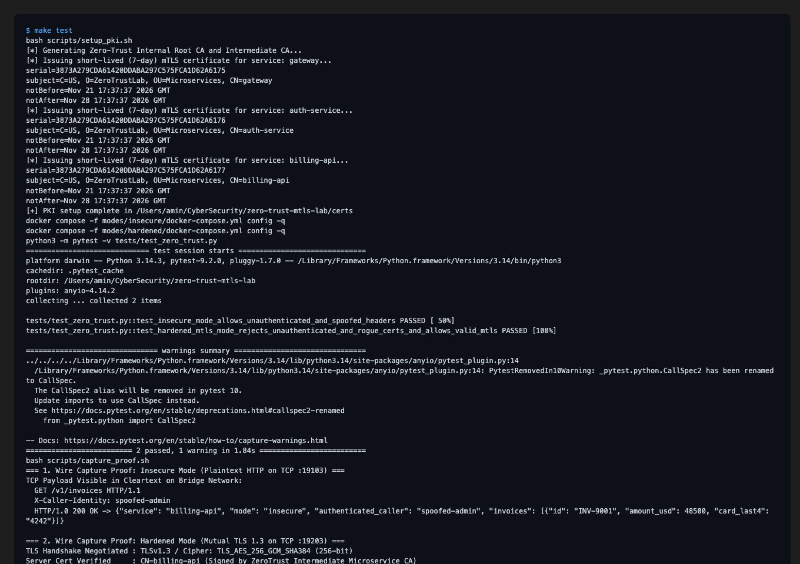

# zero-trust-mtls-lab: Zero-Trust Service-to-Service Mutual TLS (mTLS) & PKI Lab

**Problem:** Traditional perimeter security assumes internal east-west traffic between microservices (`gateway`, `auth-service`, `billing-api`) is trustworthy. In `modes/insecure/`, any container on the bridge network can query `billing-api` directly over plaintext HTTP and spoof caller headers (`X-Caller-Identity: spoofed-admin`). In `modes/hardened/`, strict **Mutual TLS (mTLS 1.3)** backed by a 2-tier internal PKI (**Root CA $\rightarrow$ Intermediate CA $\rightarrow$ 7-day leaf certificates**) requires cryptographic client & server authentication on every call.

## Architecture Diagram

```text
+-----------------------------------------------------------------------------------+
| Internal 2-Tier PKI (scripts/setup_pki.sh & scripts/rotate_certs.sh)              |
|   Root CA (4096-bit) ---> Intermediate CA (pathlen:0) ---> 7-Day Service Certs    |
+-----------------------------------------+-----------------------------------------+
                                          |
       +----------------------------------+----------------------------------+
       |                                                                     |
       vMode 1: modes/insecure/ (Plaintext HTTP)                             vMode 2: modes/hardened/ (Strict mTLS 1.3)
+-----------------------------------------+   +-----------------------------------------+
| gateway (:9101)                         |   | gateway (:9201, CN=gateway)             |
|   |-- HTTP GET /verify (No Auth)        |   |   |-- mTLS 1.3 + Client Cert CN=gateway |
|   v                                     |   |   v                                     |
| auth-service (:9102)                    |   | auth-service (:9202, verifies CN)       |
|   |-- HTTP GET /v1/invoices             |   |   |-- mTLS 1.3 + Client Cert CN=gateway |
|   |   (Vulnerable to Header Spoofing!)  |   |   |   (Rejects missing/rogue certs!)    |
|   v                                     |   |   v                                     |
| billing-api (:9103) -> Cleartext JSON   |   | billing-api (:9203) -> TLS_AES_256_GCM  |
+-----------------------------------------+   +-----------------------------------------+
```

## Before vs. After Zero-Trust Test Results (`tests/test_zero_trust.py`)

| Test Scenario | `modes/insecure/` (Plaintext HTTP) | `modes/hardened/` (Strict mTLS 1.3) | Security Outcome |
|---|---|---|---|
| Direct call to `billing-api` without client cert | `200 OK` (Exposes `INV-9001`) | **`SSLError: TLSV13_ALERT_CERTIFICATE_REQUIRED`** | Unauthenticated east-west traffic blocked at TLS handshake |
| Direct call with spoofed `X-Caller-Identity` header | `200 OK` (`spoofed-internal-admin` trusted) | **Blocked (Identity bound to X.509 `CN`)** | Header spoofing neutralized by cryptographic X.509 identity |
| Call with rogue self-signed `CN=billing-api` cert | N/A | **`SSLError: UNKNOWN_CA`** | Untrusted certificates rejected by Intermediate CA chain check |
| Authorized `gateway` $\rightarrow$ `auth` & `billing` mTLS call | `200 OK` (Cleartext on wire) | **`200 OK` (`mTLS-Verified:gateway`, TLS 1.3 AEAD)** | Cryptographically authenticated and encrypted in transit |

## Visual Proof



## Quick Start & Makefile Usage

```bash
# 1. Generate 2-tier PKI, validate Docker configs, run pytest suite, wire proof, and cert rotation
make test

# 2. Launch either deployable mode via Docker Compose
make up-insecure
make up-hardened
```
